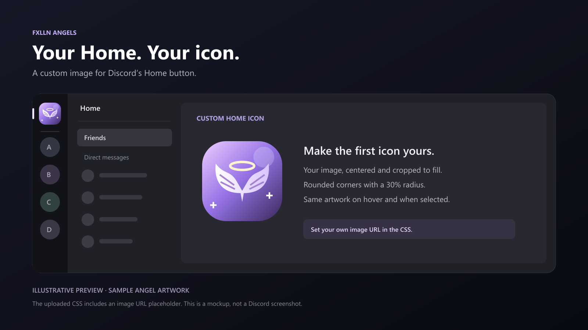
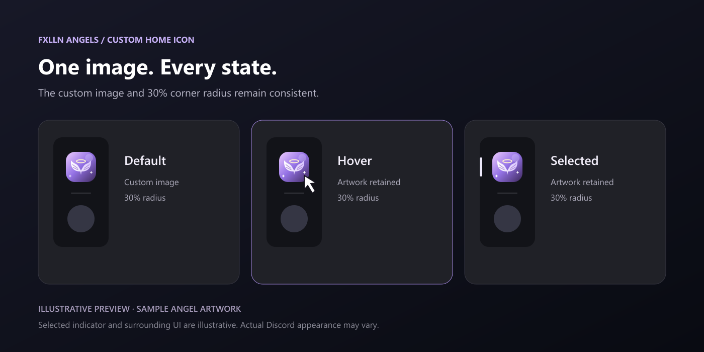

# Fxlln Angels — Custom Home Icon

Customize Discord’s Home button with your own image. The CSS keeps the custom artwork and rounded corners on hover and when selected.

## Previews

These are illustrative mockups using sample angel artwork, not screenshots of Discord. The original CSS contains an image URL placeholder; the sample artwork is not included in the CSS.

## Customize

In the CSS, replace the placeholder value for `--my-home-icon` with your image URL. The corner radius is controlled by `--my-home-radius`, which defaults to `30%`.

[Open the original CSS](%CA%9AFxlln%20Angels%C9%9E%20Custom%20Home%20Icon.css)
